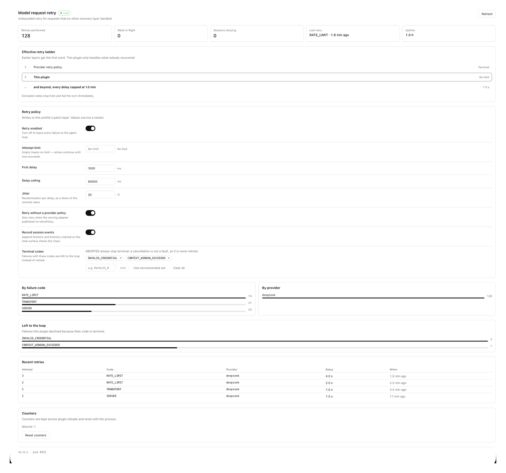
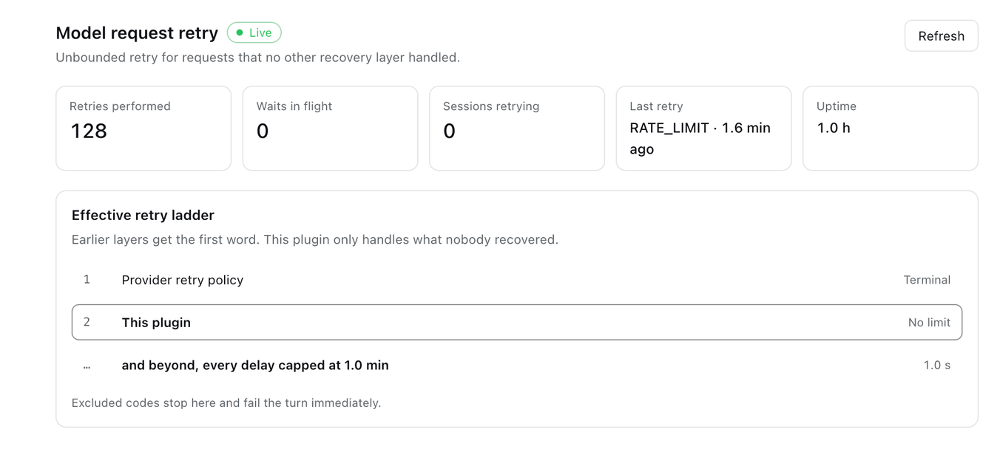

# dsh-unlimited-retry

[English](README.md) · **简体中文**

[](https://github.com/xalor888/dsh-unlimited-retry/actions/workflows/ci.yml)
[](https://www.npmjs.com/package/dsh-unlimited-retry)
[](LICENSE)
[](package.json)
[](#兼容性)

DeepSeek Harness（DSH）的**无限模型请求重试**插件，附带一个实时设置面板。

一次长时间无人值守的运行，不该因为某个请求撞上网络抖动而整个中断。这个插件让这类请求持续重试——指数退避、有延迟上限——直到成功，或直到你叫停。

标准 DSH bundle 插件，`dsh plugin` 一键安装。**同一个包同时支持 DSH Web 与官方桌面客户端**（Electron）。



<sub>图中数字为样例数据；布局、文案与控件均为插件本身。</sub>

## 装在哪里

本仓库只维护一条产品线（`main`），同一个包同时支持两种界面。

| 你要装在哪 | 安装方式 |
|---|---|
| **DSH Web 界面** | 打开**插件**页面 → 点「**添加插件**」→ 填 `dsh-unlimited-retry`；或在终端执行 `dsh plugin --profile web add dsh-unlimited-retry` |
| **官方桌面客户端（Electron）** | 打开**插件**页面 → 点「**添加插件**」→ 填 `dsh-unlimited-retry` |

### 从界面安装

两种界面都自带插件管理器，所以最快的路径是一样的：

1. 在应用里打开**插件**页面。
2. 点「**添加插件**」。
3. 填 `dsh-unlimited-retry`（要固定版本就写 `dsh-unlimited-retry@<版本>`）。
4. 确认；如果设置里没立刻出现这一页，重开应用或刷新页面。

那个输入框接受 npm 包、Git 仓库和本地目录，所以也能填
`github:xalor888/dsh-unlimited-retry` 或 `link:` 路径。

### 桌面端为什么不能用 `dsh plugin --profile desktop`

桌面端读的是名为 `desktop` 的 profile，它保留给 Electron 应用本身，命令行会**按设计拒绝**：

```
error: profile "desktop" is managed exclusively by the Electron application
```

而 `--profile web` 的命令会把插件装进 `web` profile，桌面窗口读的是 `desktop`，自然一个字也看不到。上面那条界面路径的作用域正好是「当前应用真正拥有的那个 profile」，这也是它才是正确做法。

> 为什么桌面端也能用：桌面端的 profile 就是 Web 模板（`base` + `web-app`），Electron 加载的是本地 Web UI 的 URL，因此 `dsh.client` 声明的面板在桌面端同样被 `client-modules` 装载。不需要另做一套客户端代码。
>
> 命令行 `dsh web` 用的是自己的 `web` profile；更新后重启宿主，并在浏览器 `Ctrl+F5`（Mac 为 `Cmd+Shift+R`）绕过缓存。

## 为什么要单独做一个插件

DSH 自带的 `@deepseek-ai/dsh-llm-retry` 只负责**执行**重试，真正的预算在每家 provider 适配器的 `retryPolicy` 上。它默认的 `mode: "normal"` 在 `maxRetries`（本构建是 5）之后就把决定权交出去，于是 step 失败、turn 以错误结束、整轮运行终止。`mode: "always"` 确实存在，但它是按 provider 全有全无的，而且没有延迟上限。

本插件在所有恢复层**之后**再加一层。`agent/request-error` 是 waterfall 事件，Cordis 从最外层开始依次调用，所以**最后注册的监听器在最内层**：其他所有恢复先决定，只有没人接手的失败才会落到这里。

## 实际重试顺序

按当前默认的「provider 重试 5 次」策略，实际顺序是：

| 第几次尝试 | 由谁处理 | 行为 |
|---|---|---|
| 1 – 5 | provider 的 `retryPolicy` | 它自己的预算、错误码与延迟 |
| 6 – ∞ | **本插件** | 带抖动的指数退避，封顶 `maxDelayMs` |

其他注册在同一事件上的层——上下文溢出压缩、图片卸载（`dsh-compaction-image-offload`）、别的重试插件——同样排在本插件前面。这个顺序正是本插件「最后一个注册」的全部原因，也是 provider 自身策略始终保持权威的原因。

## 是否所有情况都可用

**这是宿主插件，不是 preset 插件**，所以它对同一个 profile 启动的每个会话、每种 preset 都生效。以下都按真实契约验证过：

| 场景 | 是否生效 | 依据 |
|---|---|---|
| 任意 agent preset（standard / ptc / minimal / cordis） | ✅ | 宿主插件，不依赖 preset |
| 同一组合下的多个兄弟 agent | ✅ | 各自持有独立阶梯，互不干扰 |
| 挂载在 preset 作用域内的 agent | ✅ | 真实 Cordis 作用域分发测试通过 |
| headless / ACP / SDK 组合（无 Web 服务器） | ✅ 重试生效，无面板 | 只注册一个事件监听器，不依赖 Web 服务 |
| DSH Web 界面 | ✅ | `dsh.client` 面板 |
| 官方桌面客户端（Electron） | ✅ | 桌面 profile = Web 模板，加载同一 Web UI |
| **`ABORTED`（你主动取消）** | ❌ 设计上永不重试 | 取消不是故障 |
| provider 适配器没接纳的请求 | ❌ 到不了这里 | 不产生 `agent/request-error` |
| agent 循环拿到 turn 之前的失败 | ❌ 到不了这里 | 同上 |

## 特性

### 重试行为

- 🔁 **在诚实的地方才无限**：对「有可能恢复」的错误码不设每步次数上限，但每轮有一道硬上限，永久故障无法把一轮拖住
- ⏱️ **指数退避 + 抖动**：`initialDelayMs` 起算，每次翻倍，封顶 `maxDelayMs`，每轮叠加随机抖动避免同步风暴
- 🚧 **上限是硬约束**：`maxDelayMs` 是天花板，**任何配置冲突都以它为准**。设了 10ms 就是 10ms，不会因为 `initialDelayMs` 更大而被悄悄抬高
- 🛑 **取消永不重试**：`ABORTED` 在任何配置下都终止（见下）
- 🎯 **provider 延迟照办但封顶**：`providerRetryAfterMs` 会被尊重，同时被 `maxDelayMs` 夹住，单家 provider 无法把整轮运行无限期按住
- 🧭 **按 step 重置**：一个阶梯属于一个 step，新 step 从首次延迟重新起算，不会从上一步的天花板接着跑
- 🔌 **无 provider 策略也重试**：适配器没发布 `retryPolicy` 时同样工作（可关）

### 会话事件

每次排定的重试写入两条事件，顺序与 `dsh-llm-retry` 一致：

1. `llm/retry` —— 在等待**之前**，所以日志里记录的等待是真实发生过的；
2. `llm/retry-started` —— 在等待**之后**，请求真正重新发出的时刻。

因此被中止或插件卸载取消的重试，会留下一条 `llm/retry` 而没有对应的 `llm/retry-started` —— 这恰好就是事实。`mode` 记为 `always`，`policyKey` 固定为 `unlimited-retry`，不会与 provider 的预算冲突。

### 设置面板



- 📊 **实时状态**：小标签显示宿主端是否有响应
- 🔢 **计数器**：累计重试、等待中的请求、正在重试的会话、最近一次重试、运行时长
- 🪜 **实际重试顺序**：每次尝试会发生什么；不设上限时如实显示 `No limit`
- 📈 **分布**：按错误码、按 provider；另有一栏因错误码被判终止而主动放弃的次数
- 🕒 **最近重试**：第几次、错误码、provider、延迟、时间（相对显示）
- ⚙️ **策略编辑**：开关与数字直接经 `configEditor` 写回 profile 补丁层，重启仍生效，并热重载宿主端
- 🏷️ **终止错误码**：逐个添加（带真实错误码下拉建议），或一键套用推荐集合
- 🧹 **清零计数**：需要一次显式确认
- 🎨 **主题跟随**：只用 `--dsw-alias-*` 变量，明暗主题与后续换肤自动生效
- ♿ **可访问性**：开关是真正的 `role="switch"` + `aria-checked`，页面不在自己组件树之外写 DOM
- 🌏 **中英双语**：面板与元数据均双语

## `ABORTED`：唯一无条件终止的码

取消不是故障——要么这一轮被叫停，要么进程正在退出。`dsh-llm` 在 `signal.aborted || code === "ABORTED"` 这两种情况下都会给出 `aborted` 结束态，也就是说 **`ABORTED` 可能在循环自身的 signal 还没翻转时就到达本插件**。

重试它等于把你刚刚取消的工作重新跑一遍，所以这条判断放在 `excludeCodes` 之前，**清空该列表也不会让它恢复**。两侧匹配都忽略大小写并去除空白，因此 `Aborted`、`ABORTED`、` aborted ` 是同一个码。

面板里会显式写出这条规则，不会让它看起来像某个设置被忽略了。

## 默认值，以及它的代价

```yaml
autoRetry: true
maxAttempts: null        # 不设次数上限
initialDelayMs: 1000
maxDelayMs: 60000
jitterRatio: 0.2
retryWithoutProviderPolicy: true
retryCodes:              # Harness 自己认定可重试的那一组
  - EMPTY_RESPONSE
  - RATE_LIMIT
  - SERVER
  - TIMEOUT
  - TRANSPORT
retryAllCodes: false     # true = 除终止码外全部重试
maxRetriesPerTurn: 40    # 一轮内所有步骤合计的硬上限
excludeCodes: []
recordSessionEvents: true
log: true
markerFile: null
```

**默认只重试 Harness 自己认定的可重试错误码。** 这份列表直接取自 `dsh-llm` 的 `DEFAULT_RETRYABLE_CODES`，不是这里自己编的：它来自真正知道每种失败含义的那一层。其余一律立刻交回上层——认证、配额、计费、上下文溢出，以及**任何适配器没能归类的错误码**。

2.x 的默认正好相反，而且错得很具体、代价很高：适配器在无法归类流错误时会报一个不透明的码（`dsh-llm-pi-ai` 叫它 `PI_AI_ERROR`），而这个码同时覆盖它明确标记为不可重试的状态；于是 2.x 拿着一个永久故障、没有上限地重试，整轮永远结束不了。**一个没人认出来的错误码，不能当作「重试会有用」的依据。**

另外两道闸：

1. **`maxRetriesPerTurn`**（默认 40）是同一轮内所有步骤合计的硬上限。阶梯每步都会重置，没有它，一个跨步骤持续存在的故障会每步重新从第 1 次开始，无穷无尽。
2. **`maxAttempts`** 照旧限制每个 step。

调整范围的方式：

1. **设置 `maxAttempts`** 为正整数 —— 本插件在每个 step 重试这么多次后交回上层，效果等同于没装。
2. **放宽范围**：`retryAllCodes: true`，或把某个具体码加进 `retryCodes`；再用 `excludeCodes` 收窄，它永远优先。
3. **把错误码写进 `excludeCodes`。** 面板里有一键*使用推荐集合*，这些码的共同点是「重发一次仍然同样失败」：

   `AUTH`、`UNAUTHORIZED`、`FORBIDDEN`、`BILLING`、`QUOTA`、`ACCOUNT_QUOTA`、
   `MISSING_CREDENTIAL`、`INVALID_CREDENTIAL`、`MODEL_NOT_FOUND`、`NO_ADAPTER`、
   `CONTEXT_WINDOW_EXCEEDED`、`CONTEXT_OVERFLOW`、`CONTEXT_LENGTH`、`INVALID_REQUEST`

   > `IMAGE_OFFLOAD_REQUIRED` **故意不在**推荐集合里：`dsh-compaction-image-offload` 会靠压缩请求来恢复它，而且注册在本插件之前；它若放弃，重试才是下一步正确动作。

清空的数字字段会**回落到默认值**，而不是被当成 0（`Number(null)` 恰恰是 0，那会让延迟变忙循环、抖动变零）。

## 安装

### 从 npm（推荐）

```bash
# Web 界面
dsh plugin --profile web add dsh-unlimited-retry
```

官方桌面客户端请用应用内的「**插件 → 添加插件**」——
见 [装在哪里](#装在哪里)。命令行按设计拒绝 `--profile desktop`。

### 从本仓库

```bash
dsh plugin --profile web add github:xalor888/dsh-unlimited-retry
```

> ⚠️ npm 名与 `github:` 是同一个包名，**别混装**，先后安装会并存冲突。已是 `github:` 装的，要换 npm 名请先 `dsh plugin --profile web remove dsh-unlimited-retry`。

### 本地开发

```bash
dsh plugin --profile web add link:/绝对路径/dsh-unlimited-retry
```

装好后打开 **设置 → 重试**。

### 装完怎么自检

装完看不到面板时，按下面两条分别确认宿主半区和客户端半区是否真的挂上了：

1. **宿主半区**：`~/.dsh/adapters/unlimited-retry/mounted.json` 存在，且 `version` 就是你想装的那个版本；
2. **客户端半区**：浏览器（或桌面端开发者工具）里能取到 `/plugins/??dsh-unlimited-retry/client.js&rev=…` 并返回 `200`。

如果第 1 条通过、第 2 条失败，是客户端缓存问题——强制刷新（`Ctrl+F5` / Mac `Cmd+Shift+R`）。
如果第 1 条就不存在，插件根本没挂上，回到安装那一步，先确认装的是哪个 profile。

## 目录结构

```text
dsh-unlimited-retry/
├── package.json          # bundle 元数据（dsh.bundle.patch / dsh.client / icon / exports）
├── cordis.patch.yml      # 挂载声明，含全部默认值
├── icon.svg              # 插件列表图标（宿主读成 data URL）
├── index.js              # 宿主端：监听器 + 退避 + 会话事件 + 计数器 + 三个路由 + Config schema
├── client.js             # 浏览器端：设置面板（浏览器 bundle 格式）
├── locale/
│   ├── en.json           # 元数据标题/描述（英文）
│   └── zh.json           # 元数据标题/描述（中文）
├── test/
│   ├── host.test.mjs     # 重试判定路径 + 全部接口
│   ├── client.test.mjs   # 面板注册、双语文案、渲染、状态
│   ├── bundle.test.mjs   # 包结构、patch 完整性、图标、许可
│   └── projection.test.mjs # 真实 projection 服务 + 真实 Cordis 分发器集成测试
├── README.md / README.zh.md
└── LICENSE
```

## 配置

改 `unlimited-retry` 那一行的 `config`，或用面板。任何上层 override 都会替换**整个** `config`，所以覆盖这一行的层必须把它想保留的字段全部重述一遍。

插件同时导出 `Config` schema，因此字段会出现在 `Config.listConfigs` 里，并由 Loader 校验。

| 字段 | 类型 | 默认 | 说明 |
|---|---|---|---|
| `autoRetry` | boolean | `true` | 关掉即完全让出，等同没装 |
| `maxAttempts` | number \| null | `null` | 每个 step 的重试上限；`null`/空 = 无限 |
| `initialDelayMs` | number | `1000` | 首次退避延迟；大于上限时被上限夹住 |
| `maxDelayMs` | number | `60000` | **单次延迟天花板，冲突时以它为准** |
| `jitterRatio` | number | `0.2` | 每轮延迟的随机浮动比例（0–1） |
| `retryWithoutProviderPolicy` | boolean | `true` | 适配器没发布 `retryPolicy` 时也重试 |
| `retryCodes` | string[] | Harness 那 5 个可重试码 | 本插件会重试的错误码；其他一律交回上层 |
| `retryAllCodes` | boolean | `false` | 除取消与终止码之外全部重试 |
| `maxRetriesPerTurn` | number \| null | `40` | 同一轮内所有步骤合计的硬上限；`null` = 本轮不限 |
| `excludeCodes` | string[] | `[]` | 始终终止的错误码（大小写/空白不敏感），优先于 `retryCodes` |
| `recordSessionEvents` | boolean | `true` | 是否写入 `llm/retry` / `llm/retry-started` |
| `log` | boolean | `true` | 是否把重试决定写进 DSH 日志 |
| `markerFile` | string \| null | `null` | 可选：挂载探针文件路径（诊断用） |

## HTTP 接口

宿主端新增三个路由，注册在 DSH Web 服务器上，沿用整个组合一致的浏览器准入检查：未认证的浏览器请求 `401`，来源不可信的请求 `403`。与普通路由处理函数不同，**不会悄悄绕过 cookie 校验**。

| 路由 | 方法 | 用途 |
|---|---|---|
| `/unlimited-retry/stats` | `GET`、`HEAD` | 面板渲染的只读模型 |
| `/unlimited-retry/config` | `POST` | 校验并持久化一次策略修改 |
| `/unlimited-retry/reset` | `POST` | 清零计数（必须 `{"confirm": true}`） |

组合里没有准入服务时写操作返回 `403`；行不可寻址或没有 `configEditor` 时返回 `409`。请求体上限 8 KiB，且必须是 `application/json`。

这些路由只是给面板用的便利通道。**重试行为本身从不依赖它们**，所以 headless / ACP / SDK 组合只挂策略、完全没有路由。

## 验证

```bash
npm test        # 或 node --test test/
```

覆盖重试判定路径（委托、排除、次数上限、provider 延迟、中止、销毁、按 step 重置、1.x 旧配置键）、每个接口（状态码、`HEAD`、准入、请求体校验、未知键、推荐集合、清零确认、失败编辑器）、客户端 bundle（注册、中英键齐平与占位符校验、渲染、错误/空/只读状态、纯变量样式）、包结构（manifest、patch 字段完整性、图标、许可），以及**真实 projection 服务 + 真实 Cordis 分发器的集成测试**。

验证线上挂载（未认证返回 `401` 是正确的——请打开带认证参数的 GUI 看面板）：

```bash
curl -s http://127.0.0.1:3080/unlimited-retry/stats | head -c 400
```

## 兼容性

| 依赖 | 要求 |
|---|---|
| Node.js | **>= 20** |
| DSH | **>= 0.2.0-0 < 0.3.0-0**（`package.json` 的 `engines.dsh`，由宿主的兼容性预检强制执行）。已在 0.2.1-rc.3、0.2.1-rc.5、0.2.2-alpha.2、0.2.2-rc.1、0.2.2-rc.3 上验证 |
| 带 `dsh-agent-loop` 与 `dsh-llm-retry` | 是（重试监听器挂在那条事件上） |

会话投影读取对宿主先后提供过的两种注册形态都做了适配：0.2.2 之前 `register`
返回 disposer，0.2.2 起返回**可调用 thenable**（`typeof` 是 `"function"`，但仍带 `then`）。
有句柄时优先用句柄，因此在已弃用旧读取的运行时上不会走那条路。

`engines.dsh` 的 `-0` 下界是刻意的：宿主的预检用 `includePrerelease: true` 匹配，而只有带预发布标签的边界才能放行 `0.2.1-rc.3` 这样的预发布运行时。写成 `>=0.2.0` 会把所有 `-rc` 版本静默排除。
- 有 `AbortSignal.any` 就用它，没有则用 controller 方案等价实现。
- 1.x 的 `config` 仍可挂载：`retryAllCodes` 被忽略（除非显式排除，否则每个码都会重试），`terminalCodes` 按 `excludeCodes` 读取，两者各打一条替代提示。
- Web 面板另需 `configEditor` 与 `settings.section` 槽位；缺这些时策略照常生效，页面只是不存在或只读。

## 本插件不碰的东西：工具调用与 MCP 调用

这里的重试**只重发模型请求**，从不重跑工具。

这是结构决定的，不是承诺：`agent/request-error` 在 `dsh-agent-loop` 里只有一处触发点 —— 助手**流**以 `kind === "error"` 或 `"aborted"` 结束时 —— 而循环里的工具执行发生在消息产出之后。工具抛错不会变成 `request-error`，它会变成 `tool/result` 的失败，并由循环抛出。

这一点是对真实会话验证的，不是靠读代码推断：本机会话库里 41 条重试记录，**41 条前一条事件都是 `assistant/attempt`**（失败的流结算），没有一条前面是 `tool/result`。

所以，如果某一轮看起来在反复调用同一个工具，那个循环属于模型或工具，不属于本插件：

- **模型**一直挑那个失败的工具 —— 这是 `dsh-repeat-tool-reminder` 负责的事；
- **MCP 服务**返回错误，在修好之前会一直返回错误；
- 本插件只决定要不要重发**请求**，而且从 3.0.0 起只对那些「有可能恢复」的错误码这么做。

### 3.0.0

**破坏性变更：重试范围反过来了。** 2.x 除取消之外「什么都重试」。实际后果是：适配器无法归类流错误时给出的 `PI_AI_ERROR`（这个码同时覆盖它明确标记为不可重试的状态）被无上限地重试，于是一个跨步骤持续存在的故障让整轮永远结束不了。真实会话记录里可以看到阶梯一步一步往前走，而同一条 `tier_limit_exceeded` 一直在。

- 默认改成 Harness 自己认定的可重试集合（`EMPTY_RESPONSE`、`RATE_LIMIT`、`SERVER`、`TIMEOUT`、`TRANSPORT`）。其他一律交回上层——包括未能归类的错误码。
- `retryCodes` 与 `retryAllCodes` 把范围变成显式且可逆的设置；`excludeCodes` 始终优先。
- `maxRetriesPerTurn`（默认 40）挡住「每个步骤都重来一遍」的持续故障——只靠按步阶梯永远挡不住。
- 工具调用与 MCP 调用从来就不在本插件的重试范围内——见上一节，依据是 41 条重试记录里没有一条前面是 `tool/result`。

如果你确实依赖 2.x 的行为，设 `retryAllCodes: true`。面板的「哪些错误会被重试」卡片把它做成了一个开关，不需要改配置文件。

## 更新记录

### 2.5.1

- 基础设施版本。发布流程改用 npm 的 **trusted publishing**（GitHub OIDC），不再依赖静态 token ——
  没有凭证需要保存、轮换或续期，那个绕过 2FA 的长效 token 已经移除。

### 2.5.0

- 重试阶梯最后一行把插件的**首个**延迟印在一个标明上限的标签旁边，读起来是「此后每一次延迟均封顶 1.0 分钟 —— 1.0 秒」。现在显示上限本身。
- 同一会话有两个失败同时在等待时，较短的那个结束后「正在重试的会话」会掉到 0。改为按会话计数，而不是每会话一个布尔标记。
- 安装说明：两种界面都自带插件管理器，桌面端就是**插件 → 添加插件**。早先那版让你绕道一个对话会话来装，纯属多余。

## 发布流程

发布由 tag 驱动，任何分支都不会触发发布，且**不保存任何 npm 凭证**。工作流使用
**trusted publishing**：npm 校验 GitHub 为本任务签发的短期 OIDC token，并与登记在包上的
仓库与工作流文件比对。

```bash
# 1. 改 package.json 的版本号（以及 index.js 里的 PLUGIN_VERSION）
npm version patch --no-git-tag-version   # 或 minor / major
# 2. 提交并合入，然后在合入后的 commit 上打 tag
git tag v2.1.3 && git push origin v2.1.3
```

`Release` 工作流会：拒绝与 `package.json` 不一致的 tag → 跑测试 → 打包 →
带 npm provenance 发布 → 创建 GitHub Release 并附上 tarball → 最后从 registry
重新安装已发布版本，证明那一份也能正常挂载。它**不需要任何 secret**，只要
`id-token: write`，工作流里已声明。

`CI` 在 Node 20 / 22 / 24 上跑测试套件，然后打包、断言发布文件清单没有漂移、
装进一个干净工程，并挂载安装后的宿主端——包括「取消永不重试」这条规则。

> 集成测试（`test/projection.test.mjs`）需要真实 Harness，CI 上没有，因此在
> CI 里跳过。本地运行：
> `DSH_INSTALL_DIR=~/.local/lib/node_modules/@deepseek-ai/dsh/node_modules npm test`。

## 许可

MIT —— 见 [LICENSE](LICENSE)。
